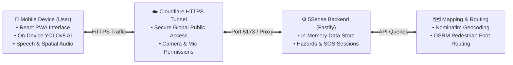
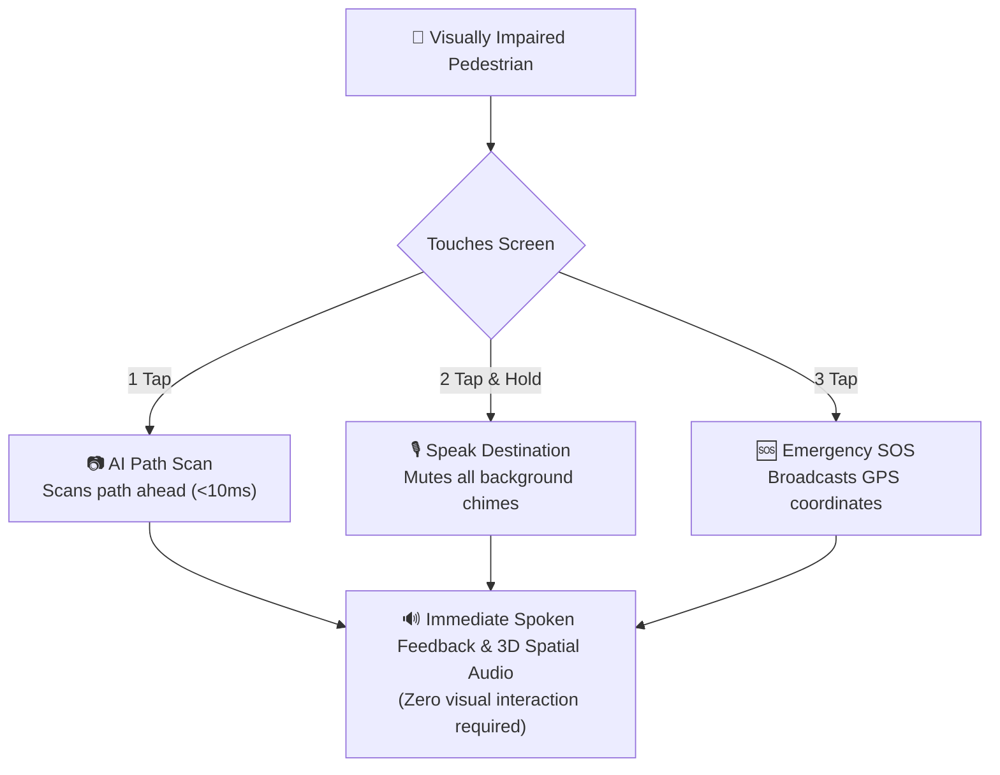
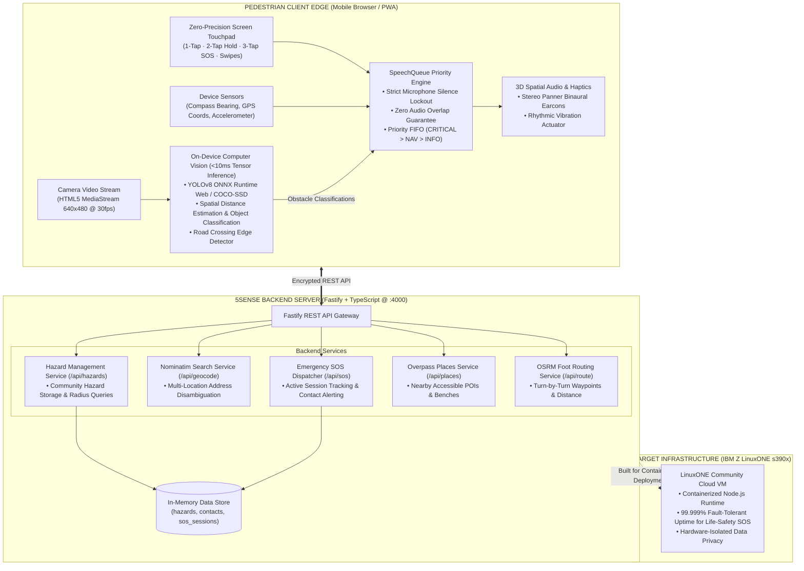
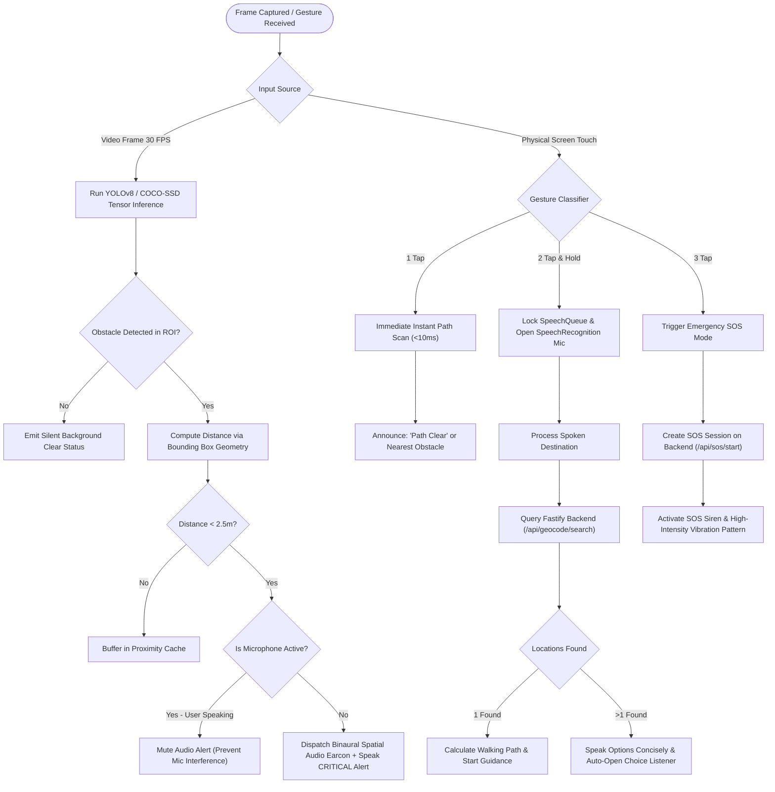
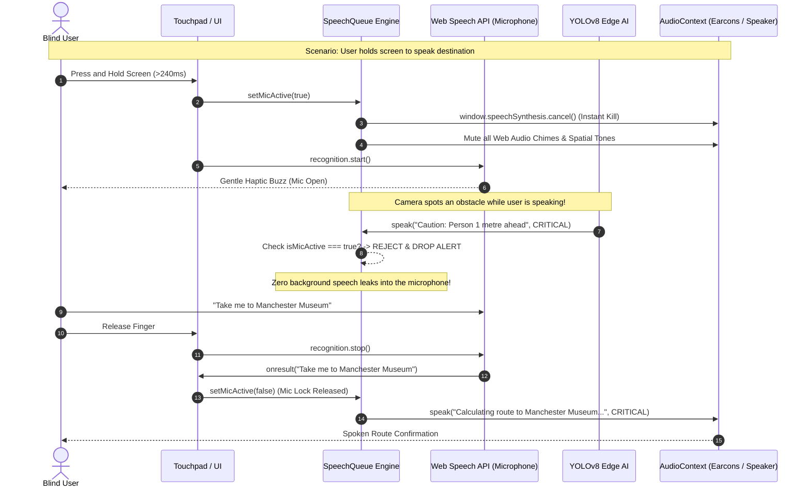
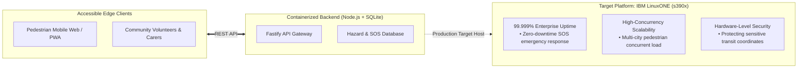

# 5Sense: Technical Architecture & Flowcharts
**IBM Z Datathon 2026 — Official Technical Design Document**

---

## ⚡ 2 Simple Flowcharts (For 3-Minute Video & Slide Deck)

### Flow 1: Simple System Architecture
*How your phone connects to the cloud and backend services:*



---

### Flow 2: Simple User Action & AI Flow
*How a visually impaired pedestrian interacts with the app:*



---

## 1. End-to-End System Architecture (Detailed)

This architecture represents the actual implementation of 5Sense: client-side on-device computer vision and zero-precision tactile input coupled with a high-performance Fastify backend service.



---

## 2. Real-Time AI Decision Pipeline



---

## 3. Zero-Precision Physical Touchpad State Machine

```mermaid
stateDiagram-v2
    [*] --> IdleState: App Mounted

    state IdleState {
        description: Screen acts as full-surface tactile sensor
    }

    IdleState --> TapDetected: Finger Touch Down
    TapDetected --> SingleTapState: Released < 240ms (1 Tap)
    SingleTapState --> IdleState: Instant Path Obstacle Audit Spoken

    TapDetected --> HoldToSpeakState: Held > 240ms (2-Tap Hold)
    state HoldToSpeakState {
        entry: SpeechQueue.setMicActive(true) -> All Audio Silenced
        description: Push-To-Talk microphone open
        exit: SpeechQueue.setMicActive(false)
    }
    HoldToSpeakState --> MultiChoiceState: Spoken Query Sent to Backend
    HoldToSpeakState --> IdleState: User Releases Finger Early

    state MultiChoiceState {
        description: Multiple destinations disambiguation modal
        listening: Auto-listen for '1', '2', or '3' with zero overlap
    }
    MultiChoiceState --> NavigationActiveState: Option Selected (Voice or Tap)
    MultiChoiceState --> IdleState: User Says 'Cancel' or Taps Close

    TapDetected --> SOSConfirmedState: 3 Rapid Consecutive Taps
    state SOSConfirmedState {
        description: Urgent SOS Dispatch with GPS Coords
    }
    SOSConfirmedState --> IdleState: User Taps 'Cancel SOS'

    IdleState --> VerticalSwipeState: Touch Drag > 45px
    state VerticalSwipeState {
        swipeUp: Repeat Last Audio Alert
        swipeDown: Spoken System Status Check
    }
    VerticalSwipeState --> IdleState: Gesture Completed
```

---

## 4. Priority-Interrupt Speech & Audio Lockout Engine



---

## 5. IBM LinuxONE Enterprise Mainframe Value Architecture


