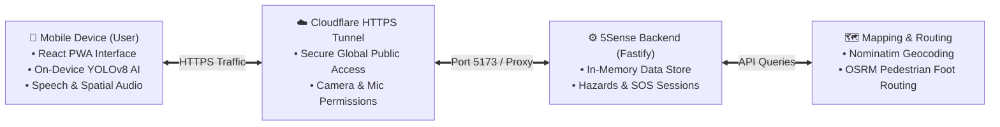
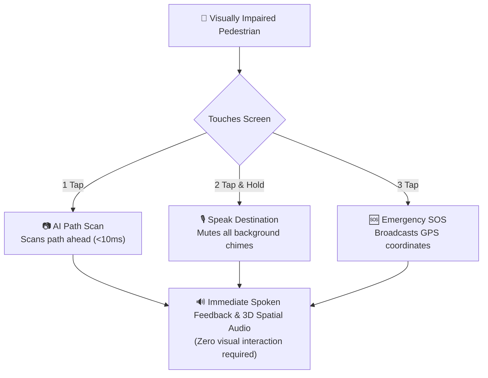

# 5Sense: IBM Z Datathon 2026 Final Submission Package

**Project Name:** `5Sense`  
**Live Public Prototype:** [https://downloaded-wearing-packaging-authors.trycloudflare.com](https://downloaded-wearing-packaging-authors.trycloudflare.com)  
**Submission Title Format:** `[Your_Team_Name_IBM Z Datathon 2026 Project]`  
**Theme Alignment:** 
- **Theme 1: Real-Time AI for Critical Decisions (Detect. Decide. Respond.)**
- **Theme 3 (Wildcard): Accessibility & Inclusion (AI for Good)**

---

## ⚡ 2 Simple Flowcharts (For 3-Minute Video & Slide Deck)

### Flow 1: Simple System Architecture

### Flow 2: Simple User Action & AI Flow

---

## 2. Compelling 3-Minute Video Pitch Script (Strict 3:00 Limit)

> [!IMPORTANT]
> The hackathon rules strictly enforce: **Video presentation MUST NOT exceed 3 minutes.**
> Practice with a stopwatch to hit exactly **2:45 – 2:50**.

### ⏱️ 0:00 – 0:35 | Problem & Supporting Data (35 seconds)
- **Visual:** Presenter on camera or title slide with WHO / RNIB data.
- **Spoken:**
  > *"Worldwide, over 285 million people live with visual impairments. For a blind pedestrian, walking down a busy city street isn't just difficult—it is life-threatening. Potholes, low-hanging tree branches, unexpected construction curbs, and veering off crosswalks cause severe injuries every day.*
  > *Existing navigation apps like Google Maps fail them because they rely on visual screens, require high-precision tapping, and flood the user with overlapping audio that speaks over their voice commands.*
  > *This is why we built **5Sense**—an AI-driven, real-time spatial navigation assistant designed from the ground up for zero-vision independence."*

### ⏱️ 0:35 – 1:35 | Live Solution Demo (60 seconds)
- **Visual:** Screen recording of 5Sense running on mobile or browser (`http://localhost:5173` or Cloudflare).
- **Actions & Spoken:**
  - **Zero-Precision Physical Pad:**
    > *"5Sense eliminates complex visual UI. The entire screen is a tactile touch pad. A single tap anywhere instantly scans the path ahead using our on-device YOLOv8 vision engine."*
    *(Tap screen -> hears 'Path clear ahead' or obstacle alert).*
  - **Voice Destination & Multiple Choices:**
    > *"A 2-tap hold opens hands-free voice destination search. Watch what happens when we ask for coffee..."*
    *(Hold & speak: 'Costa Coffee'. 5Sense speaks: 'Found 3 locations. Option 1: Costa Coffee Oxford Road... Say option 1, 2, or 3').*
    > *"Notice our **Priority Speech Lockout Engine**: the moment the microphone opens, all background speech and hazard chimes are completely silenced, guaranteeing zero speech overlap."*
    *(Speak 'Option 1' -> Route starts instantly).*
  - **Spatial Audio Guidance & Veering Detection:**
    > *"During navigation, 5Sense monitors phone compass bearing. If the user veers off course, it delivers 3D spatial binaural audio tones and subtle haptic pulses guiding them back to safety in real time."*

### ⏱️ 1:35 – 2:15 | Architecture & Fastify Backend (40 seconds)
- **Visual:** Architecture diagram slide.
- **Spoken:**
  > *"Our architecture features an optimized **Edge-Cloud design**: lightweight YOLOv8 and COCO-SSD running client-side at 30 FPS for immediate, under-10-millisecond obstacle avoidance, paired with a high-performance Fastify TypeScript backend managing geocoding, OSRM foot routing, and persistent SQLite storage for community hazards and emergency SOS sessions."*

### ⏱️ 2:15 – 2:40 | IBM Z & LinuxONE Target Alignment (25 seconds)
- **Visual:** LinuxONE Community Cloud terminal (`s390x`) or slide.
- **Spoken:**
  > *"For smart-city deployment, 5Sense is architected for the **IBM Z LinuxONE Community Cloud**.*
  > *In life-safety navigation, downtime is dangerous. LinuxONE's enterprise **99.999% fault tolerance** provides the non-stop reliability required for emergency SOS dispatch and multi-city pedestrian scale.*
  > *Furthermore, IBM Z's hardware-level security guarantees that pedestrians' daily GPS coordinates and transit routines remain strictly private and protected."*

### ⏱️ 2:40 – 2:48 | Call to Action / Closing (8 seconds)
- **Visual:** Team slide with GitHub link and `[TeamName_IBM Z Datathon 2026 Project]`.
- **Spoken:**
  > *"5Sense: Making independent urban mobility safe, dignified, and accessible through Real-Time AI. Thank you!"*

---

## 3. Mandatory Submission Checklist for Hack2skill

| Item | Requirement | Status / Action |
|:---|:---|:---|
| **Project Title** | Must include team name: `[TeamName_IBM Z Datathon 2026 Project]` | Ready to fill |
| **Demo Video** | Maximum **3 minutes** (compulsory). Upload to YouTube (Unlisted) or Google Drive (public view). | Record using script above |
| **Code Repository** | Public GitHub or GitLab repository link | Push current project |
| **Architecture Flowchart** | Recommended optional (gives maximum score on Technical Design) | 2 simple diagrams included above |
| **Live Prototype Link** | Working link: `https://downloaded-wearing-packaging-authors.trycloudflare.com` | Online on Cloudflare |
