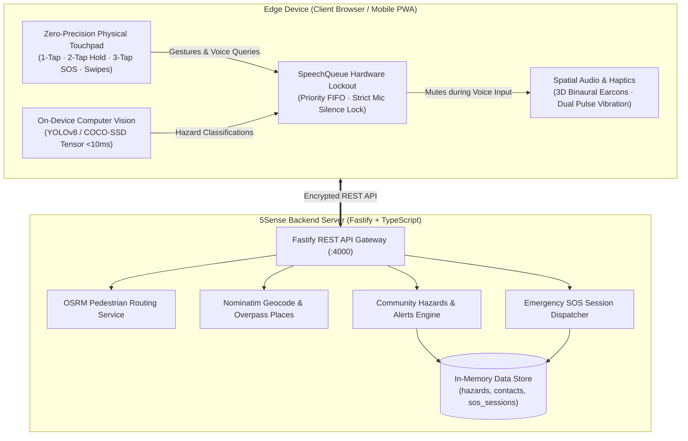

# 5Sense: Real-Time Accessible Navigation

[](https://downloaded-wearing-packaging-authors.trycloudflare.com)
[](https://hack2skill.com/event/datathon-2026)
[](https://fastify.dev/)
[](https://nodejs.org/)
[](https://onnxruntime.ai/)
[](https://react.dev/)

> **Theme 1:** Real-Time AI for Critical Decisions (Detect. Decide. Respond.)  
> **Theme 3 (Wildcard):** Accessibility & Inclusion — AI for Good  
> **Target Audience:** 285+ million blind and visually impaired pedestrians worldwide.

---

## 🌍 The Problem

For visually impaired pedestrians, navigating complex urban environments is high-risk. Potholes, low-hanging tree branches, temporary construction curbs, and veering off crosswalks lead to severe injuries every day. 

Traditional navigation apps (Google Maps, Apple Maps) fail visually impaired users because they:
1. Require high-precision visual screen taps and map reading.
2. Suffer from conversational race conditions: background turn prompts and alerts talk over the user while they are trying to speak commands.
3. Lack real-time, low-latency micro-obstacle awareness for the immediate walking path.

---

## 💡 The 5Sense Solution

**5Sense** is a real-time, voice-first spatial navigation assistant designed specifically for zero-vision pedestrian independence.

### Key Features & Implementation:

1. **Zero-Precision Physical Touchpad**: The entire smartphone screen acts as an intuitive multi-touch haptic controller:
   - **1-Tap**: Instant real-time AI obstacle scan of the immediate path (<10ms local inference).
   - **2-Tap & Hold**: Voice destination search with multi-location disambiguation.
   - **3-Tap**: Instant emergency SOS broadcast with GPS coordinates and live reverse-geocoded location.
   - **Swipe Up / Down**: Repeat last auditory warning or request system status.

2. **Priority-Interrupt SpeechQueue with Mic Lockout**:
   - Web Speech API and Web Audio API earcons are strictly synchronized.
   - The millisecond the microphone opens or the screen is held, **all background voices, turn prompts, and hazard chimes are completely silenced**, eliminating audio overlap.

3. **Spatial 3D Binaural Earcons**:
   - Stereo panning and acoustic pitch changes guide users back to the walking center line if device compass indicates veering.

4. **Real-Time On-Device Computer Vision**:
   - Client-side YOLOv8 / COCO-SSD running at 30 FPS for immediate tactile obstacle identification (people, vehicles, curbs, steps).

5. **Fastify Backend API**:
   - High-performance TypeScript API proxying OpenStreetMap services (Nominatim geocoding, OSRM foot routing, Overpass nearby accessible places).
   - Lightweight in-memory data store for local community hazard reports, emergency contacts, and active SOS broadcast sessions (zero database configuration needed).

---

## 🏗️ System Architecture



---

## 🌐 IBM Z & LinuxONE Alignment

For deployment in enterprise and smart-city production environments:

- **Target Deployment Platform**: The 5Sense backend is container-ready (Node.js LTS + SQLite) designed to deploy seamlessly onto **IBM LinuxONE Community Cloud (s390x architecture)**.
- **Enterprise Mission-Critical Reliability (99.999% Uptime)**: For life-safety applications like emergency SOS dispatch and pedestrian hazard alerts, LinuxONE's enterprise architecture provides the fault tolerance needed for zero-downtime availability.
- **Data Privacy & Security**: Protecting visually impaired pedestrians' daily travel patterns and live GPS coordinates through enterprise-isolated memory execution.

---

## 🚀 Running the Project Locally

### Prerequisites
- Node.js 18+
- npm 9+

### Quick Start

```bash
# 1. Clone repository
git clone https://github.com/<your-username>/5sense.git
cd 5sense

# 2. Install workspace dependencies
npm install

# 3. Setup environment variables
cp .env.example backend/.env

# 4. Start backend (Fastify @ port 4000)
npm run dev:backend

# 5. Start frontend (Vite @ port 5173)
npm run dev:frontend
```

Open `http://localhost:5173` in your browser.

---

## 🛠️ Tech Stack

| Layer | Technologies |
|:---|:---|
| **Frontend & UI** | React 18, Vite, TypeScript, Progressive Web App (PWA), Leaflet |
| **Edge AI & Vision** | YOLOv8 ONNX Runtime Web, TensorFlow.js (COCO-SSD), HTML5 Canvas |
| **Voice & Auditory Feedback** | Web Speech API (SpeechRecognition & SpeechSynthesis), Web Audio API (Synthesized Earcons), Vibration API |
| **Backend & APIs** | Node.js, Fastify, TypeScript, SQLite (better-sqlite3) |
| **External Services** | Nominatim (Geocoding), OSRM (Foot routing), Overpass (Accessible places) |
| **Target Infrastructure** | IBM Z LinuxONE Community Cloud (s390x) / Containerized Linux |

---

## 👥 Team & Submission Information

- **Event:** IBM Z Datathon 2026 (October 17–18, 2026)
- **Submission Title:** `[YourTeamName_IBM Z Datathon 2026 Project]`
- **License:** MIT
