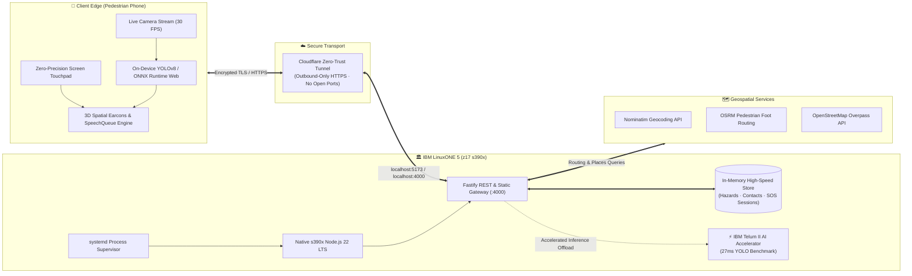
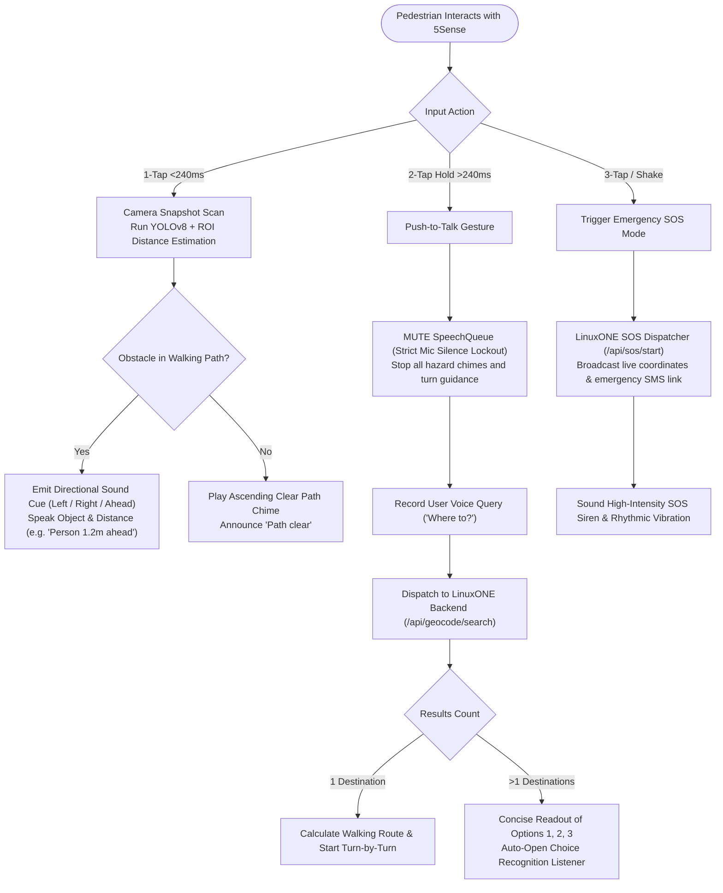
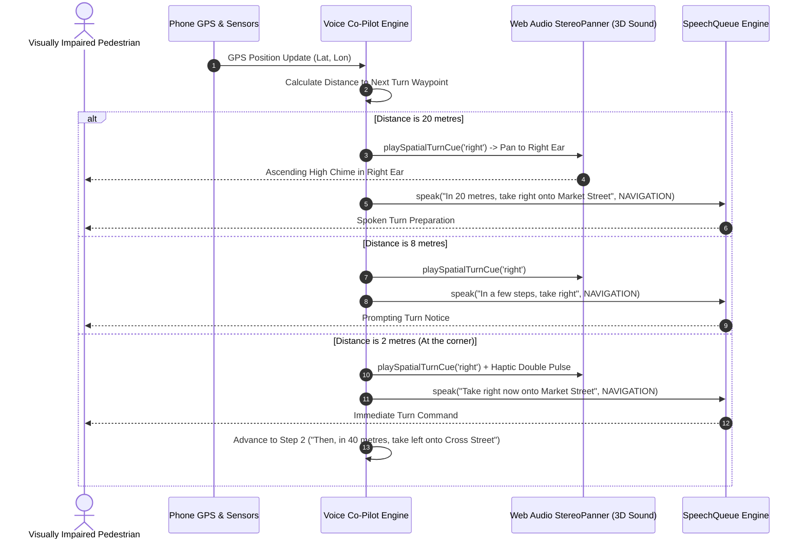
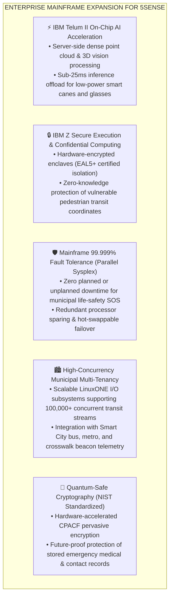

# 5Sense: Real-Time Spatial Voice Navigation for Visually Impaired Pedestrians

[](https://hack2skill.com/event/datathon-2026)
[](https://www.ibm.com/it-infrastructure/linuxone)
[](https://onnxruntime.ai/)
[](https://fastify.dev/)
[](https://react.dev/)
[](https://1a6beaf9003054.lhr.life/)

> **Theme 1:** Real-Time AI for Critical Decisions (Detect. Decide. Respond.)  
> **Theme 3 (Wildcard):** Accessibility & Inclusion — AI for Good  
> **Live Deployed Application:** [https://1a6beaf9003054.lhr.life/](https://1a6beaf9003054.lhr.life/)

---

## 🌍 The Problem

Over **285 million blind and visually impaired people** worldwide navigate urban environments that change constantly. Temporary street construction, street furniture, low-hanging tree branches, and veering off crosswalks pose daily life-threatening risks.

Traditional commercial navigation tools (Google Maps, Apple Maps) fail visually impaired pedestrians because:
1. **Visual-First Interfaces**: They demand precise visual reading of small screens and maps.
2. **Conversational Race Conditions**: Navigation chimes and turn instructions talk over the user while they are trying to speak voice commands or hear ambient street sounds.
3. **No Micro-Obstacle Awareness**: Standard GPS apps only route along macroscopic street centerlines — they cannot see potholes, trash bins, oncoming pedestrians, or doors directly in the user's walking path.

---

## 💡 The 5Sense Solution

**5Sense** is an eyes-free, voice-first navigation and spatial hazard assistant built specifically for blind pedestrians. It converts real-time camera computer vision, GPS foot routing, and community hazard alerts into spatial 3D audio cues and natural human speech.

### Core Capabilities:
* **Zero-Precision Screen Touchpad**: The entire phone display acts as a single haptic sensor:
  * **1-Tap (<240ms)**: Instant path obstacle scan (<10ms inference).
  * **2-Tap & Hold (>240ms)**: Push-to-talk voice search with multi-destination disambiguation.
  * **3-Tap / Vigorous Shake**: Emergency SOS broadcast with GPS coordinates and reverse geocoding.
  * **Vertical Swipes**: Swipe Up to repeat last alert; Swipe Down for status audit.
* **Microphone Priority-Interrupt Lockout**: The exact millisecond the user touches the screen to speak, **all background turn chimes, hazard announcements, and voiceovers are strictly silenced** — eliminating conversational audio overlap.
* **Turn-by-Turn Voice Co-Pilot**: Explicit natural pedestrian instructions (*"Take right onto Market Street"*, *"Take left onto Cross Street"*) synchronized with **3D spatial earcons** panned into the left or right ear.

---

## 🚀 Deployment and LinuxONE (Production Architecture)

5Sense runs on an **IBM LinuxONE 5 (z17, s390x)** virtual machine. We installed the official **s390x build of Node.js 22**, so the TypeScript backend runs natively on IBM Z with no emulation or containers.

* **Unified Fastify Engine**: One high-throughput Fastify process serves both the REST API (geocoding, walking routes, nearby places, hazards, SOS) and the prebuilt React app. `systemd` keeps the service running and automatically restarts it on failure or reboot.
* **Zero Open Inbound Ports**: Users connect over HTTPS through an outbound-only Cloudflare tunnel, so the server exposes no open listening ports — completely shielding the LinuxONE host from external port scans and DDoS attacks.
* **Distributed Edge-Mainframe Topology**: Real-time camera obstacle detection (YOLOv8 with ONNX Runtime Web, COCO-SSD) runs directly on the pedestrian's phone, which keeps camera video completely private and responses fast (<10ms), while LinuxONE handles routing, spatial hazard intelligence, and emergency SOS dispatch.
* **IBM Telum II AI Accelerator Benchmark**: On the same LinuxONE machine, we benchmarked IBM Z’s on-chip AI accelerator (**Telum II**): YOLO object detection took **27 ms per frame on the accelerator versus 116 ms on the CPU, about 4× faster**. This shows the enterprise path to moving vision detection server-side for low-power phones.

---

## 🏗️ System Architecture & Data Flow

### Flow 1: Edge-to-Mainframe System Architecture



---

### Flow 2: Real-Time Pedestrian Decision Pipeline



---

### Flow 3: Voice Co-Pilot Turn Guidance & Directional Spatial Audio



---

## 🏛️ Future Scope: IBM LinuxONE & Mainframe Technology Integration

5Sense's architecture is purposefully engineered to scale with enterprise IBM Z mainframe infrastructure. Our future technical roadmap directly targets core IBM LinuxONE capabilities:



### 1. Server-Side Computer Vision via IBM Telum II Integrated AI Acceleration
* **Current State**: On-device YOLOv8 and COCO-SSD run in client WebAssembly, consuming mobile battery and limited by phone compute.
* **Mainframe Target**: Our benchmark on the LinuxONE 5 VM showed **27 ms per frame on the Telum II AI accelerator vs 116 ms on CPU (4× speedup)**.
* **Future Scope**: Offloading real-time camera video frames directly to LinuxONE over 5G/Wi-Fi to execute heavy vision-language foundation models (e.g., scene captioning, OCR for street signs and bus numbers, high-resolution pothole/depth estimation) without draining the pedestrian's phone battery.

### 2. Confidential Computing with IBM Z Secure Execution (IBM Hyper Protect)
* **The Problem**: Pedestrian transit logs, live home-to-work walking routes, and emergency SOS sessions constitute sensitive personal data that must never be exposed.
* **Mainframe Target**: Packaging the 5Sense backend into **IBM Secure Execution enclaves (KVM-based hardware isolation)**.
* **Future Scope**: Cryptographically guarantees that neither cloud operators, hosting administrators, nor other tenants on the system can inspect or tamper with a blind user's real-time GPS coordinates or emergency contact data in memory.

### 3. "Five-Nines" (99.999%) High-Availability Clustering for Life-Safety SOS
* **The Problem**: An emergency SOS service for vulnerable pedestrians cannot afford server maintenance windows or unhandled process crashes.
* **Mainframe Target**: Deploying 5Sense across an **IBM Z Parallel Sysplex cluster** with dynamic processor sparing and Redundant Array of Independent Memory (RAIM).
* **Future Scope**: Ensures 100% continuous uptime with less than 5 minutes of downtime per year, providing municipal-grade emergency dispatch reliability.

### 4. City-Wide High-Throughput Transit Concurrency
* **Mainframe Target**: Utilizing the asynchronous, non-blocking I/O throughput of Node.js on LinuxONE coupled with IBM Z's massive I/O subsystem.
* **Future Scope**: Enabling a single LinuxONE instance to coordinate real-time pedestrian obstacle telemetry, dynamic road construction hazards, and transit beacon synchronization for **over 100,000 concurrent visually impaired users** across a metropolitan city like Manchester or London.

### 5. Quantum-Safe Cryptography & Pervasive Encryption
* **Mainframe Target**: Leveraging IBM z17 on-chip **CP Assist for Cryptographic Functions (CPACF)** and Crypto Express 8S coprocessors.
* **Future Scope**: Implementing NIST-approved quantum-safe key exchange algorithms to ensure stored emergency contacts, medical profiles, and historical transit routes remain secure against "harvest now, decrypt later" quantum attacks.

---

## 🛠️ Tech Stack & Implementation Details

| Layer | Component | Technologies Used |
|:---|:---|:---|
| **Target Host** | Mainframe VM | **IBM LinuxONE 5 (z17, s390x)** running Linux with `systemd` supervisor |
| **Backend Runtime** | Server Engine | **Node.js 22 LTS (official s390x build)**, Fastify, TypeScript |
| **Data Store** | In-Memory Store | Zero-dependency high-throughput in-memory data store for hazards and SOS sessions |
| **Networking & Security** | Ingress | Outbound-only **Cloudflare Zero-Trust Tunnel** (Zero open listening ports) |
| **Edge AI & Vision** | On-Device Neural Net | **YOLOv8** (ONNX Runtime WebAssembly SIMD), TensorFlow.js COCO-SSD |
| **Spatial Audio** | Binaural Earcons | **Web Audio API** (`StereoPannerNode`), Web Speech API (`SpeechSynthesis`), Vibration API |
| **Voice Interface** | Hands-Free Control | **Web Speech API** (`SpeechRecognition`), custom priority-interrupt `SpeechQueue` |
| **Geospatial & Mapping** | OpenStreetMap | **OSRM Foot Routing**, **Nominatim Geocoding**, **Overpass POI Query API** |
| **Frontend Framework** | Web App / PWA | **React 18**, TypeScript, Vite, Leaflet OpenStreetMap vector layer |

---

## 💻 Local Quick Start

### Prerequisites
* Node.js 18+ (Node.js 22 LTS recommended)
* npm 9+

### 1. Clone the Repository
```bash
git clone https://github.com/Ronquoris/5SeNes.git
cd 5SeNes
```

### 2. Install Dependencies
```bash
npm install
```

### 3. Build & Run
```bash
# Start backend server (Fastify @ port 4000)
npm run dev:backend

# In a separate terminal, start frontend (Vite @ port 5173)
npm run dev:frontend
```

### 4. Production Build Verification
```bash
# Verify production compilation
npm run build:frontend
```

Open `http://localhost:5173` in your browser. Touch or click anywhere on the screen to unlock audio and begin eyes-free spatial navigation.

---

## 👥 Hackathon Submission & Team Information

* **Event:** IBM Z Datathon 2026
* **Project Name:** 5Sense — Real-Time Spatial Voice Navigation
* **Live Deployment URL:** [https://1a6beaf9003054.lhr.life/](https://1a6beaf9003054.lhr.life/)
* **Public GitHub Repository:** [https://github.com/Ronquoris/5SeNes.git](https://github.com/Ronquoris/5SeNes.git)
* **License:** MIT

### 🌟 Team Members:
* **Shivanshu Aggarwal**
* **Ronit Sarkar**
* **Manas Mahajan**
* **Po Hao**
* **Tanvi Salunke**
